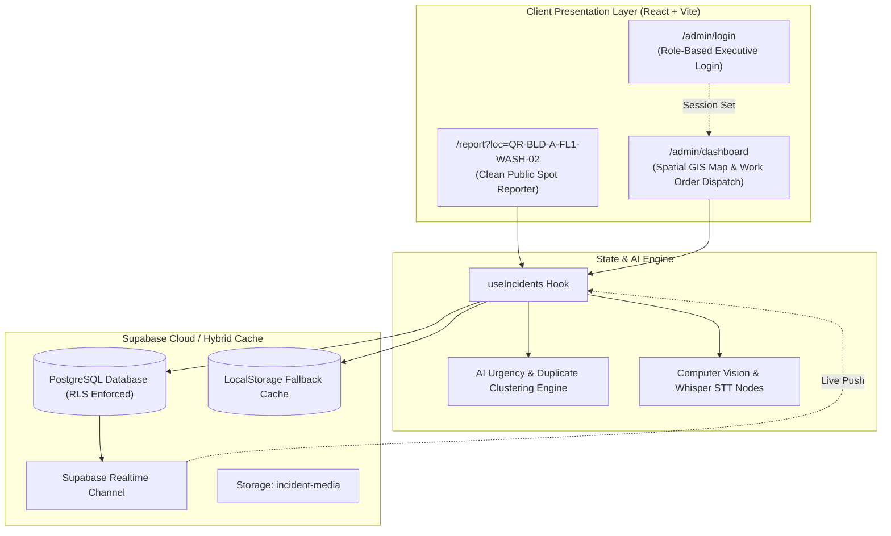

# PROJECT_CONTEXT.md — CampusPulse

> **Permanent Project Reference & Context**  
> *Project Name:* **CampusPulse**  
> *Tagline:* Zero-Login AI Campus Facility & Incident Reporting System  
> *Root Repository:* `/Users/sharath/Projects/bootcamp`  
> *Application Path:* `/Users/sharath/Projects/bootcamp/campus-guard`  
> *Last Verified:* 2026-10-30

---

## 1. Project Overview & Objectives

**CampusPulse** is a production-ready, mobile-first web application designed for higher education campuses. It provides frictionless, instantaneous reporting of physical infrastructure defects, water supply problems, classroom equipment failures, washroom sanitation hazards, and faculty suite maintenance issues.

### Core Objectives:
1. **Zero Registration Barrier:** Decouple incident submission completely from user identity. No PRNs, institutional emails, logins, OTPs, or passwords required.
2. **Universal Accessibility for Support Staff (*Aayas*):** Empower non-literate custodial workers, cleaning staff, students, and faculty via high-contrast pictographic navigation and native audio speech synthesis prompts (Web Speech API).
3. **Automated AI Triage:** Leverage Computer Vision (CV defect detection), Speech-to-Text (Whisper STT), and multi-factor urgency scoring to prioritize issues without manual sorting.
4. **Direct Executive Pipeline:** Eliminate administrative bottlenecks by routing reports directly from public intake into an executive management portal for one-click work order dispatch.

---

## 2. Problem Statement & Target Users

### Problem Statement:
Legacy campus reporting systems (e.g., CampusFix, email desks) require mandatory account registration using personal registration numbers (PRNs) or college emails before filling long multi-step web forms. This produces:
- High drop-off rates and psychological hesitation (fear of administrative retaliation or social stigma).
- Total exclusion of non-literate, non-technical support staff (*aayas*) who notice maintenance defects first.
- Delayed physical repairs resulting in water wastage, structural degradation, and interrupted lectures.

### Target Users:
1. **Students & Faculty:** Report classroom defects (sparking fans, broken projectors, broken furniture) immediately by scanning spot QR codes on desks or walls.
2. **Custodial & Support Staff (*Aayas*):** Report washroom leakages, overflowing bins, and broken taps using tactile icon buttons and push-to-talk voice notes with audio speech guidance.
3. **College Principal & Governing Management:** Oversee live spatial floor maps, track campus-wide health, inspect AI-prioritized queues, and audit resolution metrics.
4. **Maintenance Operations Directorate:** Dispatch jobs instantly via WhatsApp/SMS to on-duty plumbers, electricians, janitors, and carpenters.

---

## 3. Strict Project Constraints

| Constraint | Enforcement Rule | Rationale |
| :--- | :--- | :--- |
| **STRICT CONSTRAINT 1: Zero CR Layer** | All Class Representative (CR) triage, approval gates, and intermediate verifications are **strictly removed**. | Eliminates human bottlenecks and biases; routes reports directly: $\text{User} \rightarrow \text{AI Engine} \rightarrow \text{Admin Portal}$. |
| **STRICT CONSTRAINT 2: Clean Public Reporter** | Route `/report` must contain **ZERO** administrative details, no staff contact directories, no internal ticket queues, and no management dashboards. | Guarantees a clutter-free, privacy-first interface optimized for rapid 5-second submissions. |
| **STRICT CONSTRAINT 3: Separate Admin Portal** | Administrative operations are strictly gated behind `/admin/login` and `/admin/dashboard`. | Enforces executive access control for College Principal, Management Trustees, and Operations Heads. |

---

## 4. Technology Stack

### Frontend Application (`campus-guard/`)
- **Framework:** React 18.3 with TypeScript 5.6
- **Build Tool / Bundler:** Vite 6 (ESM production bundling with `@/` resolve alias)
- **Routing:** React Router DOM v6 (`react-router-dom`)
- **Iconography:** Lucide React (`lucide-react`)
- **Audio & Accessibility:** Native Web Speech API (`window.speechSynthesis`) for real-time bilingual voice labels
- **Styling:** Mobile-first responsive CSS design system with CSS custom properties (`src/styles/global.css`)
- **Network Access:** Enabled with `--host` support (`0.0.0.0`) for local network smartphone testing

### Backend, Database & Cloud Layer
- **Cloud Database:** PostgreSQL 15+ hosted on **Supabase** (Project Ref: `fxpjftdtfsbsthucvdpm`)
- **SDK:** `@supabase/supabase-js` v2
- **Row-Level Security (RLS):** Anonymous insert (`anon`), spot-level public read, authenticated administrative updates
- **Realtime Broker:** Supabase Realtime (`postgres_changes` on `incident_tickets`)
- **Object Storage:** Supabase Storage bucket (`incident-media`) for evidence photos and maintenance fixed proofs
- **Fallback Architecture:** Resilient local storage hybrid cache that continues working seamlessly if cloud credentials are unset

### AI & Inference Engine
- **Computer Vision (CV):** Defect classification for `water_overflow`, `pipe_rupture`, `electrical_spark`, `fan_motor_overheat`, `unhygienic_surface`, `broken_timber`
- **Speech-to-Text (STT):** Whisper-compatible transcription node with voice waveform visualizer
- **Urgency Scoring Algorithm:**
  $$\text{Priority Score} = (\text{Defect Severity } [1\text{--}10]) \times (\text{Lecture Hours Proximity } [1.0\text{--}1.3]) + (\text{Duplicate Weight}) + (\text{Media Bonus})$$
- **Smart Duplicate Clustering:** Automatically clusters submissions filed at the same `location_id` within a 30-minute window into a single primary ticket while incrementing impact counter and boosting severity score

---

## 5. System Architecture & Routes

### Route Map:
1. **`/` & `/report`:** Public Zero-Login Reporter.
   - Spot QR metadata banner (Building, Floor, Room, Fixture ID).
   - Public Spot Status Badge (`Submitted ➔ Dispatched ➔ Resolved + Fixed Proof`).
   - 4 large pictographic buttons with audio speech labels.
   - Camera button with live preview + defect tag generation.
   - 5-second voice note recorder with waveform visualizer.
2. **`/admin/login`:** Secure Executive Login form with demo accounts (Principal, Management, Admin).
3. **`/admin/dashboard`:** Live Spatial Campus Map (Floor 1, Floor 2, Floor 3), priority feed, WhatsApp/SMS dispatch, and resolution modal.

---

## 6. Database Schema & Tables (`supabase_schema.sql` / `schema.sql`)

### 1. `campus_locations`
- `location_id` (VARCHAR PK, e.g., `'QR-BLD-A-FL1-WASH-02'`)
- `building_name` (VARCHAR)
- `floor_number` (INT)
- `room_number` (VARCHAR)
- `zone_category` (VARCHAR: `WASHROOM`, `CLASSROOM`, `CORRIDOR`, `FACULTY_ROOM`)
- `gps_latitude` (NUMERIC)
- `gps_longitude` (NUMERIC)
- `fixture_id` (VARCHAR)
- `x_coord` / `y_coord` (INT for 2D floor maps)

### 2. `incident_tickets`
- `ticket_id` (VARCHAR PK, e.g., `'tick-1001'`)
- `location_id` (VARCHAR FK -> `campus_locations`)
- `category` (VARCHAR: `WATER_SUPPLY`, `LIGHTS_FAN_PROJECTOR`, `WASHROOM_CLEANLINESS`, `FURNITURE_MAINTENANCE`)
- `ai_severity_score` (NUMERIC, $1.0 - 99.5$)
- `status` (VARCHAR: `REPORTED`, `DISPATCHED`, `RESOLVED`)
- `duplicate_count` (INT, default 1)
- `voice_transcript` (TEXT)
- `voice_audio_url` (TEXT)
- `user_photo_url` (TEXT)
- `fixed_photo_url` (TEXT)
- `ai_vision_tags` (JSONB)
- `assigned_staff_id` (UUID FK -> `maintenance_staff`)
- `reported_at`, `dispatched_at`, `resolved_at` (TIMESTAMPS)

### 3. `incident_media`
- `media_id` (UUID PK)
- `ticket_id` (VARCHAR FK -> `incident_tickets`)
- `media_type` (VARCHAR: `USER_PHOTO`, `VOICE_NOTE`, `FIXED_PHOTO`)
- `file_url` (TEXT)
- `ai_vision_tags` (JSONB)
- `uploaded_at` (TIMESTAMP)

### 4. `maintenance_staff`
- `staff_id` (UUID PK)
- `full_name` (VARCHAR)
- `specialization` (VARCHAR: `PLUMBING`, `ELECTRICAL`, `CLEANING`, `CARPENTRY`, `GENERAL`)
- `phone_number` (VARCHAR, e.g., `+919876543210`)
- `is_on_duty` (BOOLEAN)

### 5. `admin_users`
- `admin_id` (UUID PK)
- `email` (VARCHAR UNIQUE)
- `password_hash` (VARCHAR)
- `role` (VARCHAR: `PRINCIPAL`, `MANAGEMENT`, `ADMIN`)
- `full_name` (VARCHAR)
- `department` (VARCHAR)

---

## 7. External Integrations & APIs

1. **WhatsApp Click-to-Chat Dispatch:**
   - URL: `https://wa.me/{phone_number}?text={encoded_job_details}`
   - Triggers pre-formatted work orders directly to field technicians with one tap.
2. **Web Speech Synthesis API:**
   - Native browser TTS reads category feedback in real-time when buttons are pressed.
3. **Supabase Realtime:**
   - WebSocket streaming channel (`public:incident_tickets`) ensures cross-device state synchronization between students and administrators.
4. **Supabase MCP Server:**
   - Configured in `~/.gemini/antigravity/mcp_config.json` for agent database management.

---

## 8. Coding Conventions & Standards

- **TypeScript Strict Mode:** All domain interfaces strictly typed in `src/types/index.ts`. No implicit `any`.
- **Component Modularity:** Single-responsibility functional components with standard React hooks (`useState`, `useEffect`, `useCallback`, `useMemo`, `useRef`).
- **Styling Architecture:** High-contrast, mobile-friendly design tokens using CSS Custom Properties. Avoid inline random hexes where design tokens exist.
- **Security Rule:** Never commit secrets, API keys, service role tokens, or sensitive credentials into Git or Markdown files. Use `.env` with `.env.example` templates.
- **Defensive Fallback:** If cloud connections fail or are unconfigured, application must function cleanly via local storage and mock data without breaking user experience.
