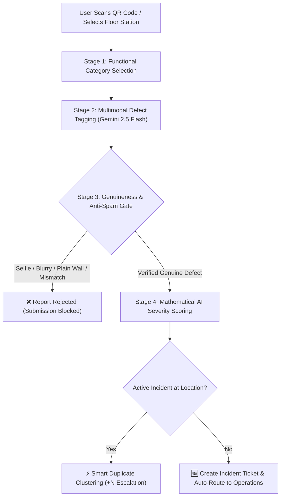

# CampusPulse — Incident Report Classification & AI Scoring Architecture

> **Document Version:** 1.0.0  
> **Target Audience:** Engineering, Product, System Administrators, Facility Operations  
> **Primary Source Code:**  
> - Vision & Verification: [`campus-guard/src/lib/defectVerification.ts`](campus-guard/src/lib/defectVerification.ts)  
> - Scoring & Clustering: [`campus-guard/src/hooks/useIncidents.ts`](campus-guard/src/hooks/useIncidents.ts)  
> - Intake Interfaces: [`campus-guard/src/pages/ReportPage.tsx`](campus-guard/src/pages/ReportPage.tsx) & [`campus-guard/src/pages/FloorReportPage.tsx`](campus-guard/src/pages/FloorReportPage.tsx)

---

## 1. Architecture Overview

CampusPulse processes and triages campus maintenance incidents through a **4-stage automated pipeline**. Every submission is evaluated for domain classification, computer vision defect inspection, anti-spam genuineness, and mathematical priority calculation before reaching the administrative dispatch queue.



---

## 2. Stage 1: Functional Category Classification

Incidents are classified into four operational domains based on campus utility impact and dispatched trade specialization:

| Category Key | Operational Domain | Base Weight | Target Maintenance Crew | Core Issue Scope |
| :--- | :--- | :---: | :--- | :--- |
| **`WATER_SUPPLY`** | Plumbing & Water | **8.5** / 10 | Plumbers | Pipe ruptures, leaking taps, overflowing basins, empty water coolers |
| **`LIGHTS_FAN_PROJECTOR`** | Electrical & Power | **8.0** / 10 | Electricians | Sparking wires, dead luminaires, fan blade wobbles, projector failures |
| **`WASHROOM_CLEANLINESS`** | Sanitation & Hygiene | **6.5** / 10 | Janitorial / Cleaning Staff | Unsanitary restrooms, clogged floor drains, bio-stains, litter build-up |
| **`FURNITURE_MAINTENANCE`** | Carpentry & Desks | **4.5** / 10 | Carpenters | Fractured benches, broken chair legs, jammed door locks, loose blackboards |

---

## 3. Stage 2: AI Defect Detection & Tagging

Multimodal computer vision runs via **Google Gemini 2.5 Flash** (with fallback to client pixel gradient analysis in [`defectVerification.ts`](campus-guard/src/lib/defectVerification.ts)).

### Standardized Tag Taxonomy

#### A. Water Supply (`WATER_SUPPLY`)
- `#water_leakage`: Active fluid dripping or escaping fixtures
- `#plumbing_joint_failure`: Coupling, flange, or valve separation
- `#pipe_rupture`: High-pressure structural line break
- `#standing_fluid_hazard`: Pooling water on corridors or classroom floors
- `#spray_dispersion_detected`: Pressurized water spray posing slip hazards

#### B. Electrical & Lighting (`LIGHTS_FAN_PROJECTOR`)
- `#electrical_fixture_defect`: General hardware failure
- `#exposed_wiring_hazard`: Open copper conductors or dangling lines
- `#blade_mechanical_fracture`: Ceiling fan structural imbalance or crack
- `#short_circuit_risk`: Thermal burns, charred switch plates, or spark risk
- `#non_operational_luminaire`: Complete darkness in study areas

#### C. Washroom Sanitation (`WASHROOM_CLEANLINESS`)
- `#sanitation_breach`: Severe hygiene failure requiring immediate chemical cleaning
- `#surface_contamination`: Soiled ceramic fixtures or unserviced basins
- `#drain_blockage`: Standing graywater or hair/debris blockages
- `#heavy_bio_staining`: Deep discoloration or unhygienic accumulation

#### D. Furniture & Carpentry (`FURNITURE_MAINTENANCE`)
- `#furniture_structural_instability`: Dangerous tilt or collapse risk
- `#timber_shear_fracture`: Broken wooden desk tops or seat panels
- `#bracket_wobble_hazard`: Missing bolts or loose welding joints
- `#exposed_fasteners`: Protruding screws or sharp metal corners

---

## 4. Stage 3: Genuineness & Anti-Spam Gate

Reports must satisfy **all 4 validation criteria** before being accepted:

```
                          IMAGE SUBMISSION
                                 │
     ┌───────────────────────────┴───────────────────────────┐
     ▼                                                       ▼
[ Layer 1: Face Guard ]                             [ Layer 2: Clarity Guard ]
FaceDetector API (~10ms)                           Rejects: #no_detectable_defects,
Rejects selfies & portraits                         #image_unclear, #blurry
     │                                                       │
     └───────────────────────────┬───────────────────────────┘
                                 │
     ┌───────────────────────────┴───────────────────────────┐
     ▼                                                       ▼
[ Layer 3: Background Wall Filter ]                 [ Layer 4: Category Alignment ]
Rejects plain painted walls                         Blocks wall photos under
without active fluid rupture/cracks                 Furniture/Water/Electrical
                                 │
                                 ▼
                     [ ✅ VERIFIED AS GENUINE ]
```

### 1. Biometric Hardware Face Guard
- Uses the native browser `window.FaceDetector` API.
- Rejects human faces, selfies, portraits, and students within **~10ms** before network calls.

### 2. Prohibited Content Keyword Matching
- **25+ Person Keywords Intercepted:** `selfie`, `face`, `person`, `human`, `portrait`, `headshot`, `student`, `people`, `man`, `woman`, `boy`, `girl`, `skin`, etc.
- **30+ Non-Defect Keywords Intercepted:** `no_detectable_defects`, `no_damage`, `image_unclear`, `blurry`, `intact`, `normal_condition`, `working_properly`, `clean_wall`, etc.

### 3. Background Wall False-Positive Suppression
- Plain walls, painted surfaces, or room shadows are **never classified as defects** unless there is active water gushing or structural masonry fracture.

### 4. Cross-Category Alignment
- If a reporter selects **Furniture / Maintenance** but uploads a photo of a plain wall, the report is blocked with:
  > *"Photo depicts a wall or background instead of the reported issue. Please photograph the physical furniture defect directly."*

---

## 5. Stage 4: Composite AI Urgency Priority Score Algorithm

The final numerical priority rating ($0$ to $100$) is computed in [`useIncidents.ts`](campus-guard/src/hooks/useIncidents.ts) using the following formula:

$$\text{Final Urgency Score} = \min\Big(99.5, \; (\text{Base Severity} \times 7.5 \times \text{Lecture Multiplier}) + \text{Duplicate Weight} + \text{Media Bonus}\Big)$$

### Mathematical Parameter Breakdown

| Parameter | Formula / Values | Operational Justification |
| :--- | :--- | :--- |
| **Base Category Severity** | `WATER_SUPPLY` = **8.5**<br>`LIGHTS_FAN_PROJECTOR` = **8.0**<br>`WASHROOM_CLEANLINESS` = **6.5**<br>`FURNITURE_MAINTENANCE` = **4.5** | High-consequence utility risks (electrical fire, water flood) naturally score higher than cosmetic carpentry wear. |
| **Lecture Hours Multiplier** | **$1.3\times$** between 8:00 AM – 5:00 PM<br>**$1.0\times$** after hours | A broken projector or sparking fan during lecture hours disrupts active classes and demands emergency dispatch. |
| **Duplicate Cluster Weight** | $\min(30, \; \text{duplicateCount} \times 3.5)$ | When $10+$ students report the same leaking pipe, crowd consensus increases priority by up to $+30$ points. |
| **Media Proof Bonus** | **$+6.0\text{ points}$** for verified photo proof | Reports with verified visual evidence take precedence over unverified reports. |

### Example Scoring Scenarios

* **Scenario A: Single Water Leak during Class Hours**
  $$\text{Score} = (8.5 \times 7.5 \times 1.3) + (1 \times 3.5) + 6.0 = 82.875 + 3.5 + 6.0 = \mathbf{92.4} \quad (\text{Urgent Dispatch})$$

* **Scenario B: Broken Desk with 15 Student Reports**
  $$\text{Score} = (4.5 \times 7.5 \times 1.3) + \min(30, 15 \times 3.5) + 6.0 = 43.875 + 30.0 + 6.0 = \mathbf{79.9} \quad (\text{High Escalation})$$

---

## 6. Stage 5: Smart Duplicate Clustering

To eliminate administrative noise and prevent technician inbox flooding:

1. **Spot Identification:** Every campus location uses a deterministic QR identifier:
   ```
   QR-[BUILDING]-[FLOOR]-[ROOM]-[FIXTURE]
   Example: QR-ENG-FL1-WASH-02
   ```
2. **Cluster Ingestion:**
   - If an active (unresolved) ticket already exists for that spot and category, the system **does not** create a new row in `incident_tickets`.
   - It increments `duplicate_count += 1`.
   - It re-computes `ai_severity_score` with the new crowd weight.
   - It updates the live UI badge:
     ```
     SMART DUPLICATE DETECTED (+15 Reports Clustered)
     ```
3. **Executive Feed Re-Ordering:**
   - Realtime Supabase WebSockets push the newly escalated ticket to the top of the Admin and Technician work queues immediately.

---

## 7. Summary Reference Matrix

| Feature | Technical Implementation | File Path |
| :--- | :--- | :--- |
| **Biometric Face Guard** | Native `window.FaceDetector` API | [`campus-guard/src/lib/defectVerification.ts`](campus-guard/src/lib/defectVerification.ts#L94-L120) |
| **AI Vision Inspection** | Google Gemini 2.5 Flash + Canvas Edge Analysis | [`campus-guard/src/lib/defectVerification.ts`](campus-guard/src/lib/defectVerification.ts#L280-L420) |
| **Genuineness Validator** | Pattern Matching (25+ person, 30+ non-defect) | [`campus-guard/src/lib/defectVerification.ts`](campus-guard/src/lib/defectVerification.ts#L180-L270) |
| **Urgency Score Formula** | Time-weighted mathematical calculation | [`campus-guard/src/hooks/useIncidents.ts`](campus-guard/src/hooks/useIncidents.ts#L323-L355) |
| **Smart Clustering** | Reactive spot deduplication & priority escalation | [`campus-guard/src/hooks/useIncidents.ts`](campus-guard/src/hooks/useIncidents.ts#L560-L650) |
