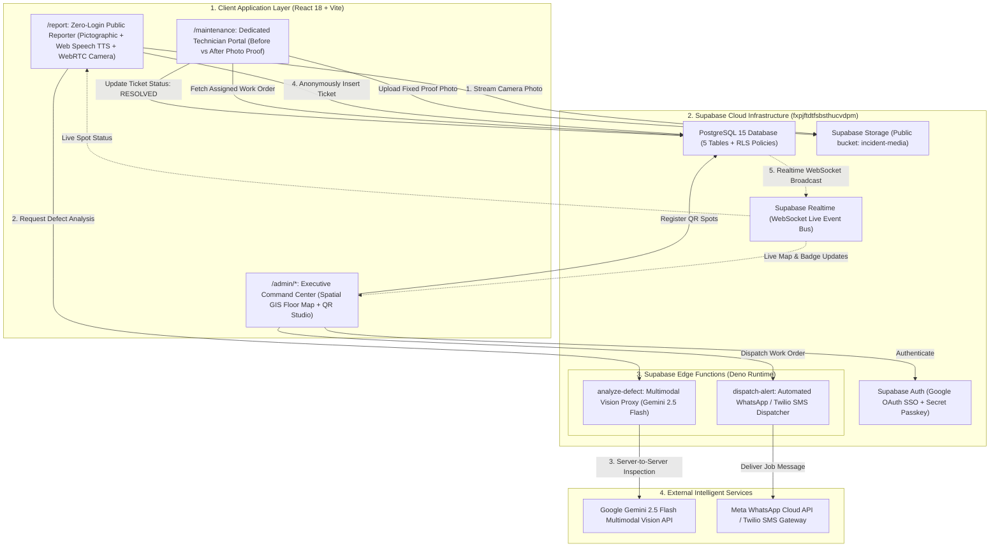
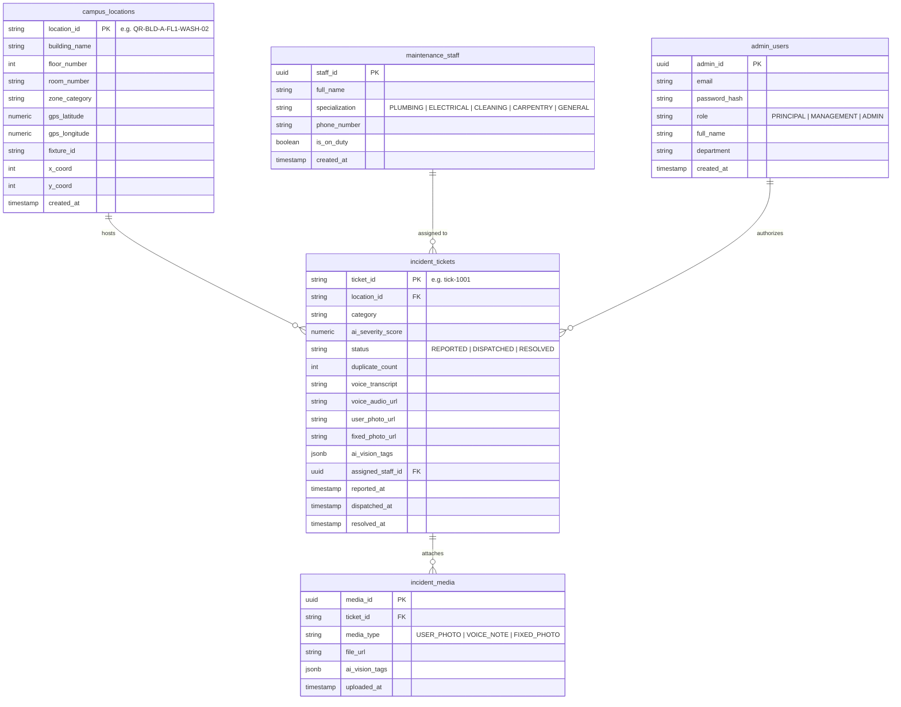

# Architecture & System Design Specification: CampusPulse

> **Living Architecture Document**  
> *Last Updated:* 2026-10-31  
> *System:* Zero-Login AI Campus Facility & Incident Reporting System (**CampusPulse**)  
> *Repository:* `https://github.com/sharath3221/campus-issue-reporter.git`  
> *Application Root:* `/Users/sharath/Projects/bootcamp/campus-guard`  
> *Database Specification:* `supabase_schema.sql` (PostgreSQL 15+ with RLS & Realtime)  

---

## 1. Executive Architecture Summary

**CampusPulse** is an enterprise-grade campus infrastructure monitoring platform designed to eliminate reporting friction, bridge the digital divide for custodial workers, and provide real-time spatial oversight to campus leadership.

### Foundational Principles:
1. **Direct Executive Pipeline (NO CR LAYER — Strict Constraint 1):** Eliminates student triage and approval queues. Reports flow directly:  
   $$\text{User Submission} \longrightarrow \text{AI Inspection} \longrightarrow \text{Executive Admin Portal} \longrightarrow \text{Technician Dispatch}$$
2. **Clean Public Interface (Strict Constraint 2):** Public route `/report` is free of administrative queues, internal metrics, and API key prompts.
3. **Isolated Admin Portal (Strict Constraint 3):** Administrative operations are gated behind `/admin/login` and `/admin/dashboard` with Google OAuth and institutional passkey authentication.
4. **Universal Accessibility for Support Staff (*Aayas*):** High-contrast pictographic category cards with real-time Web Speech API audio announcements.
5. **Physical Spot QR Ecosystem:** Spot QR codes auto-populate Building, Floor, Room, and Fixture metadata (`?loc=QR-BLD-A-FL1-WASH-02`) and provide a live public 3-step lifecycle badge with maintenance fixed photo proof.

---

## 2. End-to-End System Architecture

---

## 3. Subsystem Breakdown

### 3.1 Zero-Login Public Intake (`/report`)
- **Metadata Auto-Population:** Reads `?loc=QR-BLD-A-FL1-WASH-02` from URL parameters to identify Building, Floor, Room, and Fixture.
- **Pictographic Navigation:** 4 large, high-contrast category tiles:
  - 🚰 Water Supply & Sanitation
  - 💡 Lights, Fans & Projectors
  - 🧹 Washroom Cleanliness
  - 🪑 Furniture & Infrastructure
- **Bilingual Audio Guidance:** Web Speech API announces categories on touch for non-literate staff (*aayas*).
- **Instant Camera & Hardware Release:** Live WebRTC camera viewfinder with mandatory photo enforcement. Stops tracks, clears `video.srcObject`, and turns off the device camera light instantly on capture or close.
- **Direct Storage Streaming:** Automatically streams the captured image to the `incident-media` bucket in Supabase and attaches the public CDN URL to the report.

### 3.2 Autonomous AI Computer Vision & Urgency Scoring
- **Server-Side Edge Function (`analyze-defect`):** Client invokes the Supabase Edge Function to analyze images via Google Gemini 2.5 Flash. The `GEMINI_API_KEY` remains secret in Supabase Secrets.
- **Graceful Client Fallback:** If offline or in local development without Edge Functions, the client seamlessly falls back to direct Gemini inspection or pixel feature analysis (edges, luminance, color channel differentials).
- **AI Urgency Formula:**
  $$\text{Severity} = \min\left(99.5, \, \text{Base} \times 7.5 \times \text{ClassHoursMultiplier} + \text{DupBonus} + \text{MediaBonus}\right)$$
  - Base weights: Water (8.5), Electrical (8.0), Hygiene (6.5), Furniture (4.5).
  - Lecture hours multiplier: $1.3\times$ between 08:00 and 17:00.
  - Multi-student duplicate escalation: $+3.5$ points per student report (up to $+30$).

### 3.3 Smart Duplicate Clustering
- Priority 1: Match by exact `location_id` and `category` where `status !== 'RESOLVED'`.
- Priority 2: Match by `location_id` with any active unresolved defect.
- Increments `duplicate_count` (+N badge), updates AI severity score, and records additional voice/media evidence without spawning duplicate tickets.

### 3.4 Dedicated Maintenance Staff Portal (`/maintenance`)
- Mobile-first portal optimized for field technicians (plumbers, electricians, janitors).
- **Technician Authentication & Duty Session:** Gated by registered Phone Number / Staff ID and 4-digit PIN/Passcode (`staffAuth.ts`), persisting session in `campuspulse_staff_session`.
- **Duty Shift Management:** Live On-Duty / Off-Duty status toggle with audio feedback and real-time Supabase sync.
- **Role-Scoped Task Filter:** Toggle between "My Assigned & Trade Tasks" (filtered by staff ID or specialization) and "All Campus Jobs".
- Receives deep-links from WhatsApp dispatch alerts (`/maintenance?ticket=tick-1002`).
- **Before vs After Visual Comparison:** Displays the student's original defect photo side-by-side with the technician's live camera repair proof.
- **One-Tap Resolution:** Uploads the repaired photo directly to the `incident-media` Supabase Storage bucket and marks the ticket `RESOLVED`, instantly updating the public spot QR badge.

### 3.5 Executive Admin Portal (`/admin/*`)
- **Authentication:** Supabase Auth for Google Sign-In and institutional passkeys.
- **College Campus Architecture Builder:** Dedicated administrative builder tab ("Campus Architecture") allowing admins to:
  - Add & manage Campus Buildings / Blocks (custom names, short code prefixes, total floors).
  - Provision Starter Templates (Academic Wing, Practical Labs, Hostel & Dorms, or Custom Empty).
  - Add & configure custom Floors (Basement -1, Ground Floor 0, Floors 1..N).
  - Add individual rooms or run the 1-click **Batch Room Generator Wizard** (sequential classrooms, labs, male/female washrooms, water cooler corridors).
  - 1-click batch print floor placard sheets and single PNG sticker downloads.
  - Automatically synchronizes with Supabase `campus_locations` table and dynamically updates the Live Spatial Floor Map and Spot QR Studio.
- **Maintenance Staff Roster Management:** Complete administrative panel under the "Maintenance Staff Roster" tab to:
  - Register new technicians (Full Name, Trade Specialization, Phone Number, Login Passcode/PIN, Duty Status).
  - 1-click On-Duty / Off-Duty status toggles.
  - Delete / remove staff members.
  - Persisted to Supabase `maintenance_staff` table and synced in real time across the portal.
- **Live 2D Spatial Floor Map:** Dynamic SVG floor map with building selector, multi-floor selector (Ground, Floors 1..N), and spatial pins colored by AI urgency and progression (🔴 Urgent, 🟡 Dispatched, 🟢 Resolved).
- **One-Click WhatsApp Dispatch:** Generates pre-formatted work order messages with deep links to `/maintenance` and dispatches via Supabase Edge Function `dispatch-alert`.
- **Spot QR Sticker Generator Studio:**
  - Configurable parameters: Building Name, Floor, Room, Zone Category, Fixture ID.
  - Generates high-definition QR codes encoding the direct report URL.
  - Renders a 600×780 physical placard card with CampusPulse branding and scan instructions.
  - Saves the spot directly to Supabase `campus_locations` table.
  - Download PNG and 1-tap Print Sticker actions.
  - Campus Spots Directory with search and floor filters.

---

## 4. Database Schema Specification (`supabase_schema.sql`)

---

## 5. Security & Row-Level Security (RLS) Policies

| Table | Operation | Allowed Roles | Policy Logic |
| :--- | :--- | :--- | :--- |
| `campus_locations` | `SELECT` | `anon, authenticated` | Public read access for spot verification |
| `campus_locations` | `INSERT / UPDATE` | `anon, authenticated` | Admins can register and update campus spots |
| `incident_tickets` | `INSERT` | `anon, authenticated` | **Zero-Login intake:** Anyone can submit reports |
| `incident_tickets` | `SELECT` | `anon, authenticated` | Public can check their spot ticket status |
| `incident_tickets` | `UPDATE` | `anon, authenticated` | Dispatch and resolution updates |
| `incident_media` | `INSERT / SELECT`| `anon, authenticated` | Camera photo uploads and viewing |
| `storage.objects` | `INSERT / SELECT`| `anon, authenticated` | Read/write in `incident-media` bucket |
