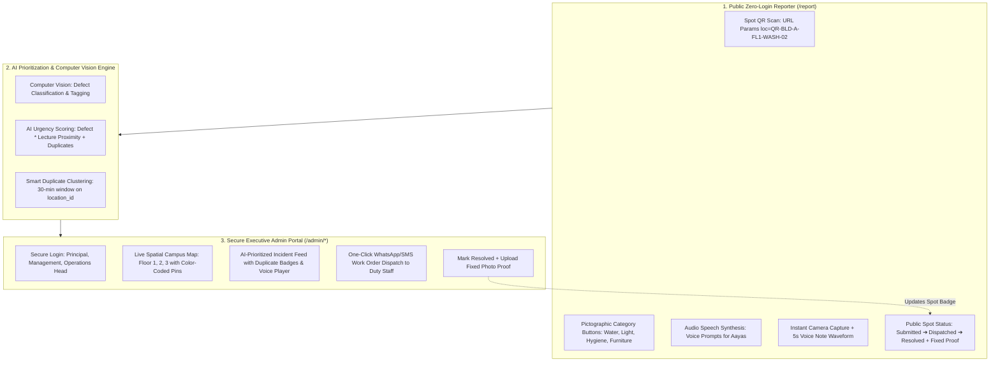
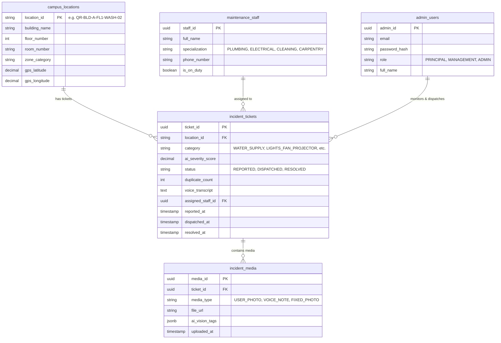
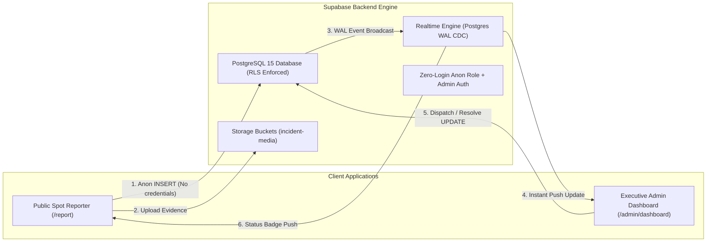

# Architecture & System Design Specification: CampusPulse

> **Living Architecture Document**  
> *Last Updated:* 2026-10-30  
> *System:* Zero-Login AI Campus Facility & Incident Reporting System (**CampusPulse**)  
> *Repository:* `/Users/sharath/Projects/bootcamp/campus-guard`  
> *Schema:* `schema.sql` (PostgreSQL 15+ Relational Specification)  
> *Note:* This document is maintained and updated dynamically across all architectural iterations.

---

## 1. Executive Summary & Paradigm Shift

Higher education campuses face widespread failure reporting breakdowns. Traditional portals demand student credentials (PRNs/SSOs), causing friction, delayed resolutions, and psychological hesitation. Furthermore, custodial personnel and non-literate support staff (*aayas*) are completely excluded from digital workflows.

**CampusPulse** provides a production-ready, mobile-first **Zero-Login AI Campus Facility & Incident Reporting System**:
- **Direct Pipeline (NO CR LAYER - Strict Constraint 1):** Removed all Class Representative (CR) triage, approval gates, and intermediate verifications. Reports go directly:  
  $$\text{User Submission} \longrightarrow \text{AI Prioritization Engine} \longrightarrow \text{Executive Admin Portal}$$
- **Clean Public Reporter (Strict Constraint 2):** Zero administrative details, no staff contact lists, no internal ticket queues, and no management dashboards exposed on public routes. 100% clean, visual, and pictographic.
- **Separate Secure Admin Portal (Strict Constraint 3):** Dedicated authentication route (`/admin/login`) strictly for the College Principal, Governing Management, and Facilities Operations Directorate.
- **Universal Accessibility for Support Staff (*Aayas*):** High-contrast pictographic buttons with real-time Speech Synthesis (Web Speech API) audio labels.
- **Spot QR Metadata & Public Status Badge:** Instant location auto-population from URL params (`?loc=QR-BLD-A-FL1-WASH-02`) with a live 3-step spot status badge `[Report Submitted ➔ Technician Dispatched ➔ Issue Resolved]` and maintenance fixed photo proof.



---

## 2. Core Constraints & Architectural Rules

1. **Strict Constraint 1 — Zero CR Layer:** All student/CR validation steps have been eliminated. Incident reports flow straight into the automated AI triage engine and directly into the Executive Admin Portal.
2. **Strict Constraint 2 — Clean Public Interface:** `/report` and `/` present only the spot location metadata, pictographic reporting cards, audio feedback, camera/voice capture, and the spot's public status badge.
3. **Strict Constraint 3 — Isolated Admin Portal:** `/admin/login` gates access to `/admin/dashboard` with Role-Based Access Control (Principal, Management, Admin) and session validation.
4. **Smart 30-Minute Duplicate Clustering:** Reports filed at the same `location_id` within a 30-minute window do not produce duplicate tickets. Instead, they increment `duplicate_count` and automatically boost the ticket's `ai_severity_score`.
5. **Two-Way Proof of Fix:** When a technician completes a repair, the admin uploads a "Fixed Photo" proof which is immediately mirrored on the public spot QR badge.

---

## 3. Database Schema (`schema.sql`)

The system uses a PostgreSQL 15+ relational schema with spatial attributes:



---

## 4. AI Prioritization & Computer Vision Engine (§4)

### 4.1 AI Urgency Scoring Algorithm
$$\text{Priority Score} = (\text{Defect Severity } [1\text{--}10]) \times (\text{Lecture Hours Multiplier } [1.0\text{--}1.3]) + (\text{Duplicate Weight}) + (\text{Media Bonus})$$

- **Defect Base Severity:**
  - `WATER_SUPPLY`: $8.5 / 10$ (active pipe bursts, hygiene hazard)
  - `LIGHTS_FAN_PROJECTOR`: $8.0 / 10$ (immediate academic disruption / electrical hazard)
  - `WASHROOM_CLEANLINESS`: $6.5 / 10$ (sanitation & odor)
  - `FURNITURE_MAINTENANCE`: $4.5 / 10$ (routine physical wear)
- **Lecture Proximity Multiplier:** If report is filed during academic hours ($08:00 - 17:00$), multiplier is $1.3\times$.
- **Duplicate Report Weight:** $\min(30, \text{duplicate\_count} \times 3.5)$.
- **Multi-Modal Verification Bonus:** $+6$ points for photo evidence, $+4$ points for voice recording.
- **Score Scale:** Normalized between $1.0$ and $99.5$ for rapid visual triage.

### 4.2 Computer Vision Defect Classification
Analyzes uploaded evidence frames to detect:
- `WATER_SUPPLY`: `water_overflow`, `pipe_rupture`, `standing_fluid`, `cooler_compressor_failure`
- `LIGHTS_FAN_PROJECTOR`: `electrical_spark`, `fan_motor_overheat`, `projector_lamp_out`
- `WASHROOM_CLEANLINESS`: `unhygienic_surface`, `waste_bin_overflow`, `odor_risk`
- `FURNITURE_MAINTENANCE`: `broken_timber`, `bracket_shear`, `lock_cylinder_jammed`

### 4.3 Smart Duplicate Clustering
When an incident is reported:
1. Look up any non-resolved ticket for the given `location_id` filed within the last 30 minutes.
2. If found:
   - Increment `duplicate_count += 1`.
   - Re-evaluate `ai_severity_score`.
   - Merge `ai_vision_tags` and append new voice note transcripts.
3. If not found:
   - Insert new ticket with `duplicate_count = 1`.

---

## 5. Mobile-First Page Architecture

### 5.1 Route: `/report` (Public Zero-Login Reporter)
- **Spot Metadata Banner:** Parses `?loc=QR-BLD-A-FL1-WASH-02` (Building, Floor, Room, Fixture ID).
- **Public Spot Status Badge:** 
  `[ Report Submitted ➔ Technician Dispatched ➔ Issue Resolved ]`
  - Real-time technician en-route indicator.
  - Fixed Photo Proof preview when resolved.
- **Pictographic Selection:** 4 large icon cards with Web Speech API audio feedback in natural voice for non-literate support staff (*aayas*).
- **Multi-Media Intake:**
  - Instant camera button with live image preview & defect tag generation.
  - 5-second voice note recorder button with animated speech waveform visualizer.

### 5.2 Route: `/admin/login` (Secure Authentication)
- Form with Email, Password, and Role selection (`PRINCIPAL`, `MANAGEMENT`, `ADMIN`).
- One-click instant demo logins for Dr. Anand Sharma (Principal), Rajiv Mehta (Management), and Sunil Verma (Admin).

### 5.3 Route: `/admin/dashboard` (Executive Command Center)
- **Live Spatial Campus Floor Map:**
  - Interactive multi-floor selector (Floor 1, Floor 2, Floor 3).
  - Color-Coded Spatial Pins:
    - 🔴 **Red Pin:** Active / Critical Incident (AI Severity $\ge 80$).
    - 🟡 **Yellow Pin:** Work Order Dispatched (Technician En Route).
    - 🟢 **Green Pin:** Issue Resolved with Proof.
  - Pin-click highlights and filters the matching ticket in the feed.
- **AI-Prioritized Incident Feed:**
  - Sorted by AI urgency score.
  - Duplicate counter badge (e.g. `+14 students reported this same leak`).
  - Voice note audio player with transcript.
  - Uploaded photo proof with AI Computer Vision defect tags.
- **One-Click WhatsApp/SMS Dispatch:**
  - Selects duty staff (Plumber, Electrician, Janitor, Carpenter).
  - Generates pre-formatted WhatsApp job dispatch text.
  - Updates ticket state to `DISPATCHED`.
- **One-Click Resolution with Fixed Photo Proof:**
  - Attaches fixed photo URL.
  - Transitions ticket to `RESOLVED` and updates the public spot badge.

---

## 6. Supabase Backend Architecture & Realtime Cloud Layer

CampusPulse integrates **Supabase** (PostgreSQL 15+) as the unified cloud database, object storage, and realtime event broker:



### 6.1 Row-Level Security (RLS) Policies
- **Anonymous Submission (`anon` role):** Zero-login public users can anonymously insert tickets (`FOR INSERT TO anon WITH CHECK (true)`).
- **Public Spot Status Read:** Anyone scanning a Spot QR code can read the status of incidents at that specific location.
- **Administrative Operations:** Authenticated users (`authenticated` and `service_role`) can update work order status, assign duty technicians, and upload fixed photo proofs.

### 6.2 Realtime Event Subscriptions
The application subscribes to `postgres_changes` on the `incident_tickets` table:
- New ticket insertions dynamically render as color-coded spatial pins on the Admin 2D floor map.
- Dispatch and Resolution events push instant updates to the public user's spot progress badge.

### 6.3 Media Object Storage (`incident-media`)
- Stores user-captured photo frames, 5-second voice notes, and maintenance fixed photo proofs.
- Configured with public read access and sanitized file naming conventions (`uploads/{timestamp}_{filename}`).

---

## 7. Directory Structure

```
campus-guard/
├── ARCHITECTURE.md                  # This living architecture specification
├── supabase_schema.sql              # Supabase PostgreSQL migration & RLS script
├── schema.sql                       # Standard ANSI/Postgres schema reference
├── .env.example                     # Supabase environment variable template
├── index.html                       # CampusPulse HTML5 shell
├── package.json                     # React 18, TypeScript, Supabase JS, Lucide icons
├── tsconfig.json                    # TypeScript compiler configuration
├── vite.config.ts                   # Vite bundler configuration
└── src/
    ├── main.tsx                     # React 18 createRoot & BrowserRouter
    ├── App.tsx                      # Clean routing: /report & /admin/*
    ├── lib/
    │   └── supabaseClient.ts        # Supabase JS SDK client with hybrid fallback
    ├── types/
    │   └── index.ts                 # Domain models, Category & Status metadata
    ├── styles/
    │   └── global.css               # Design tokens, mobile-first utility classes
    ├── data/
    │   └── mockData.ts              # Spot locations, maintenance staff, admin users
    ├── hooks/
    │   └── useIncidents.ts          # State engine: Supabase sync, Realtime, AI scoring
    └── pages/
        ├── ReportPage.tsx           # Public Zero-Login Reporter (Strict Constraint 1 & 2)
        ├── AdminLoginPage.tsx       # Separate Secure Login (Strict Constraint 3)
        └── AdminDashboardPage.tsx   # Executive GIS Map & Work Order Dispatch Feed
```

---

## 8. Architectural Evolution & Changelog

| Version | Date | Changes & Milestones | Author |
| :--- | :--- | :--- | :--- |
| **v1.0.0** | 2026-10-30 | Initial multi-tier incident prototype. | Engineering Team |
| **v2.0.0** | 2026-10-30 | **Major Architecture Overhaul (CampusPulse):**<br>• Enforced Strict Constraint 1: Removed all Class Representative (CR) triage and verification layers.<br>• Enforced Strict Constraint 2: Cleaned public user page (`/report`) to have ZERO administrative details.<br>• Enforced Strict Constraint 3: Built dedicated secure Admin Portal (`/admin/login` & `/admin/dashboard`).<br>• Implemented Pictographic UI with Web Speech API audio guidance for support staff (*aayas*).<br>• Built 3-step Public Spot Status Badge with fixed photo proof.<br>• Implemented Multi-Floor Spatial GIS Campus Map with 🔴/🟡/🟢 color-coded pins.<br>• Implemented AI Urgency Scoring formula & smart 30-minute duplicate report clustering.<br>• Added One-Click WhatsApp/SMS maintenance job dispatch.<br>• Authored production PostgreSQL schema (`schema.sql`). | Full-Stack AI System Architect |
| **v2.1.0** | 2026-10-30 | **Supabase Cloud Database Integration:**<br>• Installed `@supabase/supabase-js` SDK.<br>• Created `supabase_schema.sql` with RLS policies (zero-login public inserts, admin dispatch updates).<br>• Added Supabase Realtime replication for instant cross-device synchronization between public spot badge and admin floor map.<br>• Implemented Supabase Storage bucket (`incident-media`) integration.<br>• Implemented `supabaseClient.ts` with graceful hybrid offline/local cache fallback. | Full-Stack AI System Architect |
| **v2.2.0** | 2026-10-30 | **Supabase MCP Server & Agent Skills Configuration:**<br>• Configured `~/.gemini/antigravity/mcp_config.json` with Supabase MCP Server (`project_ref=fxpjftdtfsbsthucvdpm`) with docs, account, database, debugging, and development features.<br>• Installed official Supabase agent skills (`supabase`, `supabase-postgres-best-practices`) via `npx skills add supabase/agent-skills`.<br>• Auto-populated `VITE_SUPABASE_URL=https://fxpjftdtfsbsthucvdpm.supabase.co` in `.env`. | Full-Stack AI System Architect |
